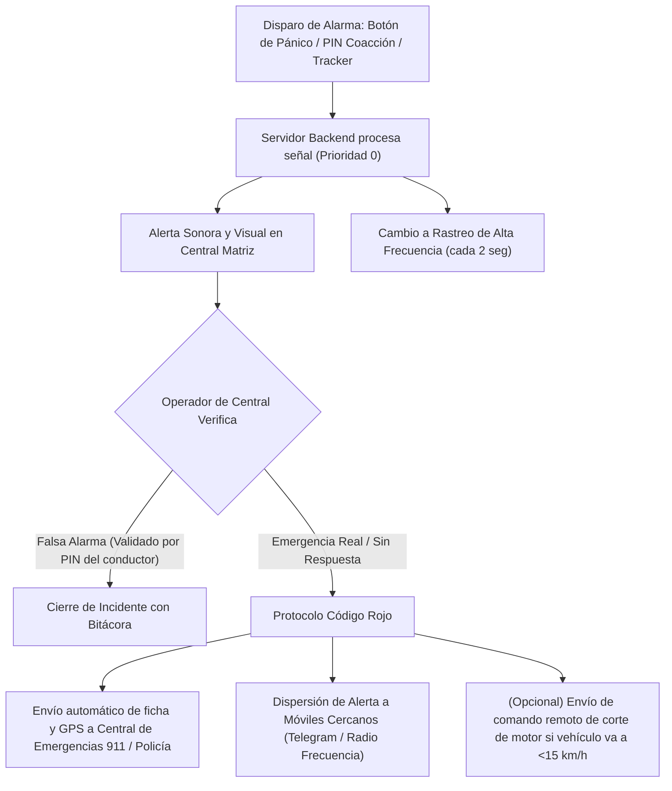

# PROYECTO: SISTEMA INTEGRAL DE SEGURIDAD, TELEMETRÍA Y GESTIÓN PARA TAXIS Y TRANSPORTE PÚBLICO

**Estado del Documento:** Borrador Técnico Revisado y Ampliado  
**Versión:** 2.0  
**Licencia:** Código Abierto (Open Source - GPLv3 / Apache 2.0)  
**Objetivo:** Brindar protección integral en ruta al conductor, monitoreo en tiempo real por parte de la central matriz y respuesta inmediata ante emergencias delictivas o mecánicas.

---

## 1. VISIÓN GENERAL DE LA ARQUITECTURA

El sistema se compone de un ecosistema distribuido en 4 capas:
1. **Dispositivos en Vehículo:** Aplicación Móvil Android (Conductor), Aplicación en Radio Android (Opcional) y Dispositivo GPS Tracker IoT de hardware con botón de pánico físico cableado e inmovilizador de motor.
2. **Servidor Central / API Backend:** Servicio en la nube de alta concurrencia con recepción de telemetría en tiempo real (MQTT / WebSockets / TCP Sockets para trackers GPS).
3. **Base de Datos Central:** PostgreSQL + PostGIS (datos geoespaciales para tracking, geocercas y rutas) con capa de caché en Redis para estado en tiempo real.
4. **Programa Matriz (Central de Monitoreo y Despacho):** Panel de control para operadores de la cooperativa/asociación con mapa en vivo, gestión de flota, recepción de alertas y automatización de avisos a autoridades y grupos de apoyo.

```
                      ┌──────────────────────────────────────────────┐
                      │              VEHÍCULO (CONDUCCIÓN)           │
                      │  ┌──────────────┐      ┌──────────────────┐  │
                      │  │ Móvil Driver │      │ Tracker GPS / IoT│  │
                      │  │ (App Android)│      │ (Hardware Oculto)│  │
                      │  └──────┬───────┘      └────────┬─────────┘  │
                      │         │  Boton BT / Pánico    │            │
                      └─────────┼───────────────────────┼────────────┘
                                │ HTTPS / WebSockets    │ TCP / UDP (M2M)
                                ▼                       ▼
                      ┌──────────────────────────────────────────────┐
                      │          BACKEND / NUBE CENTRAL              │
                      │  - API REST (FastAPI / Node.js)              │
                      │  - Broker MQTT / WebSockets (Telemetría)     │
                      │  - Socket Server GPS (Traccar / Protocolos)  │
                      │  - PostgreSQL + PostGIS + Redis              │
                      └─────────────────┬────────────────────────────┘
                                        │
                         ┌──────────────┴──────────────┐
                         ▼                             ▼
              ┌────────────────────┐         ┌───────────────────┐
              │  CONSOLA MATRIZ    │         │ DIFUSIÓN Y ALERTA │
              │ (Panel Operadores) │         │ - Webhook WhatsApp│
              │ - Monitoreo Mapas  │         │ - Bot Telegram SOS│
              │ - Despacho Auxilio │         │ - Enlace ECU-911  │
              └────────────────────┘         └───────────────────┘
```

---

## 2. ANÁLISIS CRÍTICO Y EVALUACIÓN DE VIABILIDAD DEL PLANTEAMIENTO INICIAL

A continuación se detalla la crítica técnica, legal y de seguridad sobre las premisas del borrador previo:

| Propuesta Original | Viabilidad Técnica | Riesgo Operativo / Legal | Solución Recomendada (v2.0) |
| :--- | :--- | :--- | :--- |
| **"En Android la aplicación está oculta"** | **Inviable** en Google Play estándar sin permisos MDM / Device Owner. Android 10+ impide ocultar iconos de launchers comunes. | Si la app está 100% oculta, el taxista no puede interactuar rápidamente con ella. | **Modo Camuflaje / Discreto:** La app se presenta con nombre o icono neutro (ej. "Calculadora de Rutas" o "Mantenimiento"), o se activa mediante un atajo por botones de hardware (doble clic en volumen/power) o botón Bluetooth periférico. |
| **"Bloquear funcionalidades del teléfono en momento de peligro"** | **Peligro Crítico para la vida del conductor**. Si un asaltante nota que el teléfono se congeló/bloqueó al intentar robarlo, sospechará inmediatamente de una alarma silenciosa y puede agredir al conductor. | El taxista pierde la capacidad de llamar o pedir rescate por sus propios medios si el teléfono se auto-bloquea. | **Modo Simulación (Duress / Pantalla Falsa):** La app apaga la pantalla simulando que el celular murió por falta de batería o muestra una pantalla estándar rota/bloqueada, mientras en segundo plano transmite audio en vivo y coordenadas GPS en alta frecuencia. |
| **"Llamar automáticamente al 911 desde la app"** | **Restringido por Android OS**: Android bloquea llamadas automáticas directas al 911 sin confirmación manual en el dialer para evitar spam por falsos toques. | Alto riesgo de sanciones por falsos positivos (multas por llamadas falsas al 911). | La app envía la señal de pánico de inmediato a la **Central Matriz**. El operador de la central (humano o despacho automático verificado) valida la alerta e ingresa el reporte oficial al 911 / ECU-911 con la ficha del vehículo y ubicación exacta. |
| **"Desconectar sólo con permiso de la matriz"** | **Imposible de forzar físicamente**: El usuario o asaltante puede apagar el celular, activar Modo Avión, retirar el chip SIM o entrar a una zona sin señal. | Provoca estados zombi en la matriz si el teléfono simplemente se quedó sin batería. | **Mecanismo Heartbeat / Dead-Man:** El móvil emite pulsos de vida cada $N$ segundos. Si la señal se interrumpe sin un "Checkout Autorizado" previo, la matriz levanta una **Alerta por Pérdida Anómala de Señal**. |
| **"Alertas masivas automáticas por WhatsApp a grupos"** | **Alto Riesgo de Baneo:** Usar librerías no oficiales (tipo `pywhatkit` o scripts web) en WhatsApp resulta en baneo definitivo del número en cuestión de días por políticas antispam de Meta. | Caída del canal de comunicación en plena emergencia. | Uso de **WhatsApp Business Cloud API** oficial para números de emergencia, complementado con **Grupos de Telegram (Bots)** que son ilimitados, gratuitos y no sufren baneos por envío masivo automatizado. |

---

## 3. ESPECIFICACIÓN TÉCNICA DETALLADA

### 3.1. Aplicación Android para el Conductor (APK)
* **Lenguaje/Framework recomendado:** Flutter (Dart) o Kotlin Nativo.
* **Módulos Principales:**
  1. **Servicio en Primer Plano (Foreground Service):** Notificación persistente con `WAKE_LOCK` para garantizar que el sistema operativo no cierre el proceso de geolocalización al apagar la pantalla.
  2. **Telemetría Inteligente:** Envío de coordenadas cada 5 segundos si el vehículo se mueve ($>5$ km/h), y cada 60 segundos si está detenido (ahorro de batería y datos móviles).
  3. **Botón de Emergencia SOS:**
     - Botón virtual en pantalla con confirmación por deslizamiento (slide to activate) para evitar toques involuntarios.
     - Botón silencioso mediante combinación de teclas físicas (ejemplo: pulsar botón de bajar volumen 4 veces seguidas).
     - Compatibilidad con pulsadores Bluetooth BLE (botón oculto en el volante o pedal).
  4. **Protocolo de Coacción (PIN Bajo Presión):**
     - Si el delincuente obliga al taxista a "desactivar la alarma", el conductor ingresa un **PIN de Coacción** (ej. `9999` en vez de `1234`). La app aparenta cerrarse normalmente, pero en secreto eleva la prioridad de alerta a "Secuestro / Coacción en curso".
  5. **Conexión / Desconexión Segura:**
     - Solicitud de inicio de turno (check-in) con validación de selfie y kilometraje.
     - Solicitud de cierre de turno (check-out) validada por la matriz o por geocerca de parada/hogar segura.

### 3.2. Hardware de Respaldo en el Vehículo (Tracker GPS IoT)
Para eliminar la dependencia exclusiva del smartphone del conductor:
* **Dispositivo:** Tracker GPS M2M (modelos estándares del mercado: Teltonika FMB920, Coban 303 o SinoTrack).
* **Alimentación:** Conectado directamente a la batería del vehículo (12V/24V) con batería interna de respaldo de al menos 4 a 6 horas.
* **Pulsador de Pánico Oculto:** Botón tipo microswitch oculto bajo la palanca de cambios, alfombra o bajo el volante.
* **Relé de Corte de Ignición (Inmovilizador):** Capacidad de apagar el motor remotamente desde la consola matriz una vez confirmada la emergencia y cuando el vehículo reduzca la velocidad a un nivel seguro ($<15$ km/h).

### 3.3. Aplicación en Radio Android (Opcional)
* Instalación en radios tipo pantalla táctil con Android automotriz.
* Función como nodo espejo: si el celular del conductor deja de emitir, la radio toma el rol de rastreador si cuenta con ranura 4G LTE o antena GPS activa.

### 3.4. Programa Matriz (Central de Control y Despacho)
* **Arquitectura:** Aplicación Web moderna (React / Vue + FastAPI / Node.js) accesible por los despachadores de la cooperativa.
* **Funcionalidades:**
  1. **Monitoreo Cartográfico en Vivo:** Mapa interactivo (Leaflet / OpenStreetMap / Google Maps) mostrando todos los móviles:
     - 🟢 Verde: En servicio / Normal.
     - 🟡 Amarillo: Detenido / Fuera de ruta / Espera.
     - 🔴 Rojo parpadeante: Alarma de Emergencia Activa.
     - ⚫ Gris: Desconectado / Sin señal prolongada.
  2. **Historial de Rutas y Reproducción:** Guardado de trayectorias con velocidad, marcas de tiempo y eventos de parada.
  3. **Módulo de Asistencia e Incidentes:** Registro de horas de guardia, turnos, pagos de cuotas y antecedentes de incidentes.
  4. **Centro de Despacho de Auxilio:**
     - Botón de reenvío de ficha policial con un solo clic (Placa, Modelo, Color, Nombre del Socio, Foto, Ubicación en tiempo real).
     - Integración con canales de Telegram / WhatsApp para alertar a unidades circundantes en un radio de $X$ kilómetros.
  5. **Impresión y Exportación Forense:** Reportes en PDF con historial de ruta minuto a minuto certificado para entrega a fiscalía o aseguradoras en caso de robo o siniestro.

---

## 4. MODELO DE BASE DE DATOS (ESQUEMA RELACIONAL)

Para reemplazar la arquitectura local monousuario por una base de datos distribuida y escalable (PostgreSQL):

```sql
-- Conductores / Socios
CREATE TABLE conductores (
    id SERIAL PRIMARY KEY,
    cedula_identidad VARCHAR(20) UNIQUE NOT NULL,
    nombres VARCHAR(100) NOT NULL,
    apellidos VARCHAR(100) NOT NULL,
    telefono VARCHAR(20) NOT NULL,
    contacto_emergencia_nombre VARCHAR(100),
    contacto_emergencia_telf VARCHAR(20),
    foto_url TEXT,
    activo BOOLEAN DEFAULT TRUE,
    creado_en TIMESTAMP DEFAULT CURRENT_TIMESTAMP
);

-- Vehículos / Taxis
CREATE TABLE vehiculos (
    id SERIAL PRIMARY KEY,
    placa VARCHAR(15) UNIQUE NOT NULL,
    numero_unidad VARCHAR(10) NOT NULL,
    marca VARCHAR(50),
    modelo VARCHAR(50),
    anio INT,
    color VARCHAR(30),
    imei_gps_tracker VARCHAR(30) UNIQUE,
    id_conductor_asignado INT REFERENCES conductores(id)
);

-- Sesiones de Turno (Conexión / Desconexión)
CREATE TABLE turnos (
    id SERIAL PRIMARY KEY,
    id_conductor INT REFERENCES conductores(id),
    id_vehiculo INT REFERENCES vehiculos(id),
    hora_inicio TIMESTAMP DEFAULT CURRENT_TIMESTAMP,
    hora_cierre TIMESTAMP NULL,
    km_inicio INT,
    km_cierre INT,
    estado VARCHAR(20) DEFAULT 'ACTIVO' -- 'ACTIVO', 'CERRADO_NORMAL', 'CERRADO_FORZADO'
);

-- Puntos de Telemetría (PostGIS)
CREATE TABLE tracking_posiciones (
    id BIGSERIAL PRIMARY KEY,
    id_vehiculo INT REFERENCES vehiculos(id),
    latitud DOUBLE PRECISION NOT NULL,
    longitud DOUBLE PRECISION NOT NULL,
    velocidad FLOAT DEFAULT 0.0,
    rumbo FLOAT DEFAULT 0.0,
    nivel_bateria INT,
    origen VARCHAR(20), -- 'APP_MOVIL', 'GPS_HARDWARE', 'RADIO_ANDROID'
    creado_en TIMESTAMP DEFAULT CURRENT_TIMESTAMP
);
CREATE INDEX idx_tracking_vehiculo_fecha ON tracking_posiciones (id_vehiculo, creado_en DESC);

-- Incidentes y Alarmas de Emergencia
CREATE TABLE alarmas_emergencia (
    id SERIAL PRIMARY KEY,
    id_vehiculo INT REFERENCES vehiculos(id),
    id_conductor INT REFERENCES conductores(id),
    tipo_alerta VARCHAR(50) NOT NULL, -- 'PANICO_BOTON', 'COACCION_PIN', 'PERDIDA_SENAL', 'CORTE_ENERGIA'
    latitud DOUBLE PRECISION NOT NULL,
    longitud DOUBLE PRECISION NOT NULL,
    estado VARCHAR(30) DEFAULT 'ABIERTA', -- 'ABIERTA', 'VERIFICANDO', 'POLICIA_NOTIFICADA', 'FALSA_ALARMA', 'RESUELTA'
    observaciones_operador TEXT,
    fecha_alerta TIMESTAMP DEFAULT CURRENT_TIMESTAMP,
    fecha_resolucion TIMESTAMP NULL
);
```

---

## 5. PROTOCOLO DE ACTUACIÓN ANTE EMERGENCIAS (SOP)



---

## 6. HOJA DE RUTA DE DESARROLLO (ROADMAP)

1. **Fase 1: Backend Base y Plataforma Matriz Web (Mes 1)**
   - Configuración de base de datos PostgreSQL/PostGIS.
   - Creación de API REST de autenticación y gestión de conductores, vehículos y turnos.
   - Dashboard web de monitoreo con visualización de mapa en tiempo real.
2. **Fase 2: Aplicación Móvil Android (Mes 2)**
   - Desarrollo del servicio de segundo plano para tracking GPS continuo.
   - Implementación del botón de pánico, modo camuflaje y PIN de coacción.
   - Módulo de comunicación WebSocket para envío continuo de datos y recepción de instrucciones.
3. **Fase 3: Integración de Hardware GPS e Inmovilizador (Mes 3)**
   - Configuración de servidor de sockets (Traccar o custom listener) para recibir tramas de trackers GPS físicos (Teltonika/Coban).
   - Pruebas de conmutación automática: si el celular se apaga, el tracker GPS asume el reporte de posición.
4. **Fase 4: Sistema de Difusión de Alertas y Enlace Externo (Mes 4)**
   - Integración con bots de Telegram y canales WhatsApp Business API.
   - Formato exportable estandarizado para entrega inmediata a autoridades (911 / Policía Nacional).
   - Generador de reportes históricos e impresión de rutas para auditoría.
